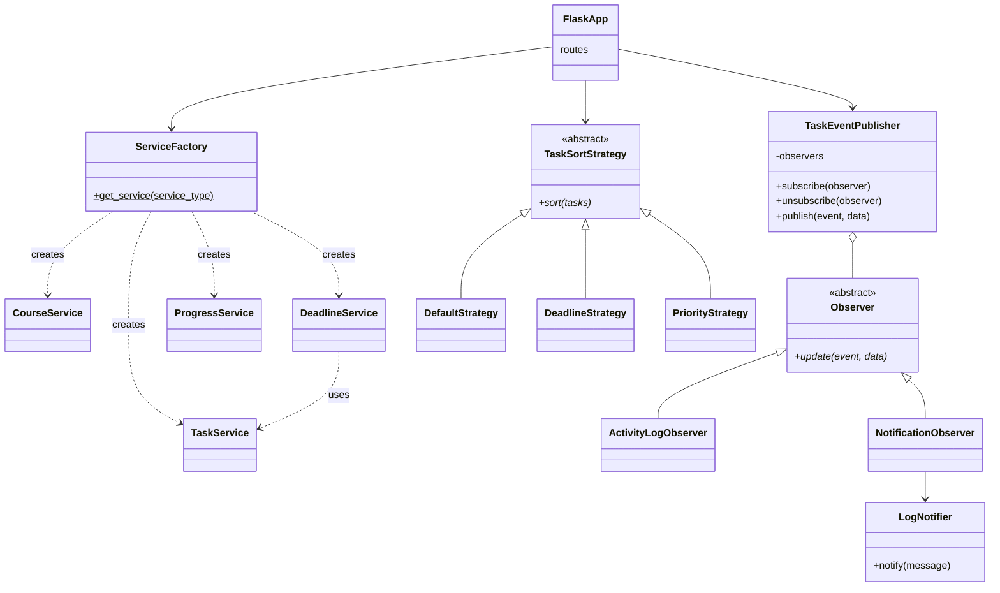

# Student Study Planner — Project Report
CSE 3206 Software Engineering Sessional (22 Series) · Jit Banerjee Mithun · ID 2203127

Repository: https://github.com/jit10920/StudentStudyPlanner

## 1. Requirements

### Functional requirements
| ID | Requirement | Module |
|----|-------------|--------|
| FR1 | Add, search, list and delete courses (name, unique code, semester) | Course Management |
| FR2 | Add tasks with title, description, course, deadline, priority; complete and delete them | Task Management |
| FR3 | Sort tasks by deadline, priority or creation order; filter by status | Task Management |
| FR4 | Group pending tasks into overdue / today / next 7 days / later / no deadline | Deadline Management |
| FR5 | Show completion percentage per course and overall | Progress Tracking |
| FR6 | Record every task change automatically and show it in a log | Activity Log |
| FR7 | Dashboard with totals, overdue count, overall progress, upcoming tasks | Dashboard |
| FR8 | JSON API for courses, tasks and progress, documented with OpenAPI/Swagger | API |

### Non-functional requirements
- **Persistence:** all data stored in SQLite (`study_planner.db`).
- **Extensibility:** new services plug in through `ServiceFactory`; new sort orders are one new `TaskSortStrategy` subclass; new reactions to task events are one new `Observer`.
- **Maintainability:** layered code (routes → services → database); unit-test coverage above 85% enforced in CI.
- **Usability:** Bootstrap UI, responsive, flash messages for every action.
- **Reliability:** input validation on forms and API; one failing observer cannot break a request.

### User stories
1. As a student, I want to register my courses so I can attach tasks to them.
2. As a student, I want to give a task a deadline and priority so I know what to do first.
3. As a student, I want to see what is overdue or due this week so I do not miss deadlines.
4. As a student, I want to see how much of each course I have finished so I can plan my time.
5. As a student, I want a history of what I changed so I can review my work.
6. As a developer, I want API documentation so I can integrate a mobile client later.

### Prototype / mock-up
Navigation bar: Dashboard · Courses · Tasks · Deadlines · Progress · Activity · API. Dashboard shows four stat cards, an overall progress bar, upcoming tasks and courses. *(Insert screenshots of each page here.)*

## 2. Process model: Incremental (with Agile-style short iterations)
The system was built in increments, each delivered on its own feature branch and merged by pull request:
1. Course management → 2. Task management → 3. Factory pattern → 4. Strategy pattern → 5. Deadline, progress, activity (Observer), API/OpenAPI, Selenium and CI.

**Why:** the requirements were small and stable but the modules are fairly independent, so a working increment could be tested and merged each time. **Rejected:** Waterfall, because I could not know every detail up front and wanted feedback from running code; full Scrum, because there is a single developer and no product owner.

## 3. Design patterns

| Pattern | Category | Where | Problem solved | Rejected alternative |
|---------|----------|-------|----------------|----------------------|
| Factory | Creational | `factories/service_factory.py` | Routes should not know which concrete service class to use; new modules are registered in one place | Importing every service directly in `app.py`, which spreads construction logic and makes swapping services hard |
| Strategy | Behavioral | `strategies/` | Task sort order must change at runtime without editing the route | `if/elif` chain inside the route, which grows with every new sort and is hard to test |
| Observer | Behavioral | `events/observers.py` | Task changes must trigger logging and notifications without the task code knowing about them | Calling the log and notifier directly from each route, which couples routes to every side effect |

Three patterns from two categories (creational, behavioral).

### UML class diagram

## 4. Software testing
- **TDD:** for the new modules the tests (`test_progress.py`, `test_deadlines.py`, `test_events.py`, `test_api.py`) were written first and failed (red) before the services were implemented (green).
- **Mocks** (`unittest.mock`): `Mock` observers verify the publisher; a `MagicMock` database verifies `ActivityLogObserver` without SQLite; a `Mock` notifier isolates the notification channel; a `Mock` publisher is injected into the app to check which events the API emits.
- **Selenium:** `tests/e2e/test_selenium.py` drives headless Chrome against a live server: add course, add and complete a task, check progress, activity log, navigation.
- **CI:** GitHub Actions (`.github/workflows/ci.yml`) runs unit tests with a coverage gate, then the Selenium tests, on every push and pull request.

### Test report (local run)
- 61 unit/integration tests pass; 4 Selenium tests are in `tests/e2e`.
- Coverage summary (`pytest --ignore=tests/e2e --cov`): **93% overall** (372 statements, 25 missed); all service, strategy, factory, observer and API modules are 80–100%; `app.py` is 86%.
- *Selenium result: paste the passing GitHub Actions run here.*

## 5. Configuration management
Branch naming: `feature/<topic>`. Existing history: `feature/task-management`, `feature/course-management`, `feature/factory-pattern`, `feature/strategy-pattern`, merged through pull requests #1–#3, with one merge conflict resolved in commit `665091f`.
Branches still to be created and merged for this increment are listed in the README section "Git workflow for the final increment". *(Insert screenshots of the PR list, the rejected/revised PR, the conflict resolution and the commit history.)*

## 6. New tool: OpenAPI / Swagger
- **Why:** the project had no machine-readable description of its interface, so any client (or a future mobile app) would depend on reading the code.
- **What was done:** a JSON API (`api.py`) was added and described in `openapi.py`; Swagger UI is served at `/api/docs`, the spec at `/api/openapi.json`.
- **Real use, not a demo:** `tests/test_api.py` validates the spec against the OpenAPI 3 schema with `openapi-spec-validator`, and a contract test fails if any documented operation has no matching Flask route, so documentation cannot silently drift from the code. CI runs these on every pull request.
- **Alternative compared:** `flask-restx`/`flasgger` generate the spec from decorators. Rejected: they add a framework dependency and tie route code to the documentation library; a hand-written spec plus a contract test keeps the app plain Flask and teaches the OpenAPI format itself. Postman collections were also rejected because they are not tied to the code or to CI.

## 7. AI assistance statement
An AI assistant (Claude) was used to help build the increment described in sections 3–6 (progress, deadline and activity modules, Observer pattern, API/OpenAPI, tests, CI workflow) and to draft this report. I reviewed the code and must be able to explain every part in the viva.
